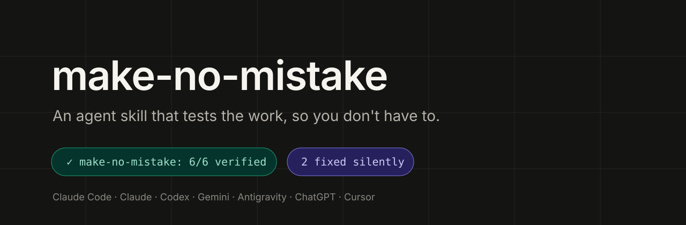
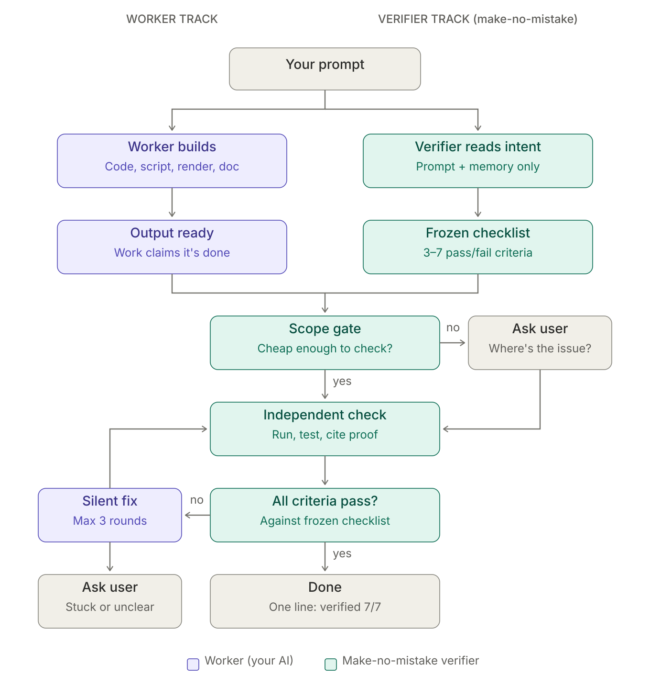
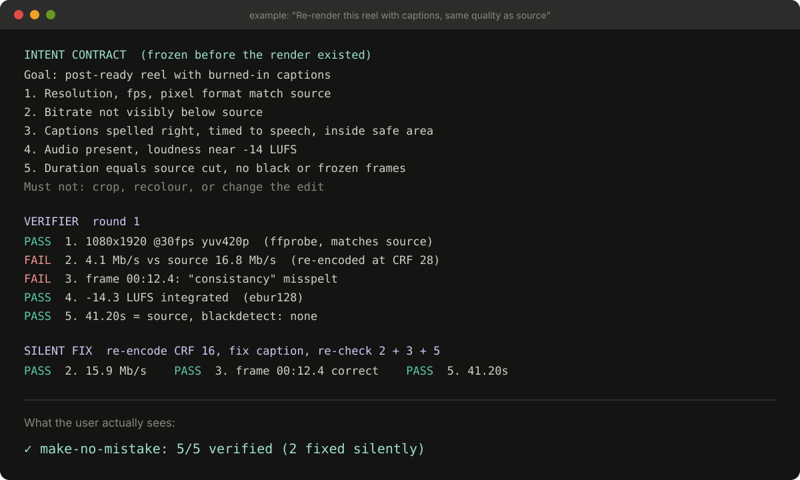

<p align="center">
  
</p>

# make-no-mistake

People end prompts with "make no mistake" as a joke. This skill makes it an actual mechanism.

**make-no-mistake** is an agent skill that checks every piece of work your AI does against what you actually asked for, then fixes whatever fails before handing it back. You stop being the tester. You don't re-read the diff, re-watch the render or re-check the doc. You get the finished thing and one line saying it was verified.

It works on code, scripts, video renders, documents, designs and data. It runs in Claude Code, Claude, Codex, Gemini, Antigravity, ChatGPT and Cursor.

---

## How it works

<p align="center">
  
</p>

Your prompt goes down two tracks at once.

**Worker track (purple).** Your AI does the job as it normally would: writes the code, the script, the render or the doc.

**Verifier track (teal).** At the same time, make-no-mistake reads only your prompt and your known preferences, and writes an **intent contract**: 3–7 pass/fail criteria for what "done" means, plus a "must not" list. It's written *before any output exists* and then frozen. That's what keeps the check honest. The verifier can't adjust the bar after seeing the work.

Then the two tracks meet:

| Stage | What happens in the backend | Why |
|---|---|---|
| **Scope gate** | Estimates how expensive checking will be. It checks only what changed. If verifying would mean reading 20+ unseen files or 2,000+ lines, or needs something only you can see, it asks you one question: *where's the issue?* | Keeps token use sane on big codebases and long media. |
| **Independent check** | A fresh sub-agent gets only three things: your original request, the frozen contract and where the output is. It never sees the worker's reasoning. It runs, tests, opens, renders and measures the output, and gives every criterion `PASS`, `FAIL` or `UNVERIFIED` with proof. | A model grading its own work agrees with itself. A stranger with only the spec doesn't. |
| **All criteria pass?** | Compares the verdicts to the contract. "Looks good" doesn't count. No evidence means `UNVERIFIED`, never `PASS`. | Stops rubber-stamping. |
| **Silent fix** | Fixes only what failed, with the smallest change, then re-checks the failures plus anything the fix could break. **Maximum 3 rounds.** No progress chatter. | You asked for a working result, not a play-by-play. The cap stops endless loops and runaway tokens. |
| **Ask user** | Only when it's genuinely stuck: 3 rounds spent, the same failure twice, the fix needs info only you have, the fix is irreversible, or two of your requirements conflict. | The only times your input actually changes the outcome. |
| **Done** | One line at the end of the reply. | You know it ran, without a report to read. |

Where a tool can't run a separate sub-agent (ChatGPT, Claude chat), the check runs in **fresh-eyes mode**. The same model re-reads your original message word for word, judges the output as if a stranger made it, and assumes something is broken until it's proven otherwise. It's weaker than a true second agent, but it follows the same contract and the same evidence rules.

### What a run looks like

<p align="center">
  
</p>

The user only ever sees the last line.

---

## Install

### Claude Code (fully automatic)

```bash
git clone https://github.com/deepanshutomar/make-no-mistake.git
cp -r make-no-mistake/skills/make-no-mistake ~/.claude/skills/
mkdir -p ~/.claude/hooks
cp make-no-mistake/hooks/make-no-mistake-stop.sh ~/.claude/hooks/
```

Then merge `hooks/settings.example.json` into `~/.claude/settings.json`. That adds a **Stop hook**: every time Claude tries to finish a turn, the hook blocks the first attempt and tells it to run make-no-mistake. The second attempt always goes through, so it can't loop forever. This is what makes it run without being called.

### Claude (web, desktop, mobile)

Zip the `skills/make-no-mistake` folder and upload it as a custom skill in Claude's settings. Claude loads it based on the skill description. There's no hook here, so triggering depends on the model picking it up.

### Codex, Gemini CLI, Antigravity, Cursor

- If your tool loads `SKILL.md` skills, drop `skills/make-no-mistake/` into its skills folder.
- Otherwise paste the block from [`portable/AGENTS.md`](portable/AGENTS.md) into `AGENTS.md` (Codex), `GEMINI.md` (Gemini CLI), your Antigravity rules or your Cursor rules.

### ChatGPT

Paste the block from [`portable/AGENTS.md`](portable/AGENTS.md) into a Project's instructions or a custom GPT's instructions. The short custom-instruction fields are too small for the full block.

### How each platform behaves

| | Auto-trigger | Independent verifier | Runs code / probes files |
|---|---|---|---|
| Claude Code | ✅ Stop hook | ✅ sub-agent | ✅ |
| Codex / Gemini CLI / Antigravity | via rules file | ✅ where sub-agents exist | ✅ |
| Cursor | via rules file | fresh-eyes mode | ✅ |
| Claude / ChatGPT (chat) | via skill description / instructions | fresh-eyes mode | where code execution is on |

The idea is the same everywhere. The strength varies with what each tool can do.

---

## Repo layout

```
make-no-mistake/
├── skills/make-no-mistake/
│   ├── SKILL.md                    the skill: contract → gate → check → fix → finish
│   └── references/
│       ├── verifier-prompt.md      prompt handed to the independent verifier
│       └── checks.md               per-type checks: code, scripts, video, docs, design, data
├── hooks/
│   ├── make-no-mistake-stop.sh     Claude Code Stop hook (auto-trigger, loop-safe)
│   └── settings.example.json
├── portable/AGENTS.md              compact always-on version for any tool
└── assets/                         diagrams and images (SVG source + PNG)
```

The skill uses progressive loading. `SKILL.md` stays small, and the verifier opens only the section of `checks.md` that matches the output type. That's part of the token budget too.

## Design rules it never breaks

- The contract is written before the output exists, and never edited to make the output pass.
- No `PASS` without evidence produced in that turn.
- Fixing means meeting the contract. It never expands the scope.
- Untouched work that was already verified doesn't get checked again.
- Your later instruction always overrides the contract.

## Limits, honestly

- It can't verify what it can't observe: your phone, your account, a real customer's reaction. Those come back as `UNVERIFIED` with a reason, never as a fake pass.
- Fresh-eyes mode is weaker than a separate verifier agent. Use a tool with sub-agents for high-stakes work.
- It checks against what you *asked*. If the request itself was wrong, it will faithfully verify the wrong thing. It asks up front only when an ambiguity is expensive to get wrong.

## License

MIT © Deepanshu Tomar
